<!-- DYNAMIC HEADER BANNER -->

<!-- TYPING SVG SUBTITLE -->

 

<!-- EXECUTIVE CONTACT & CREDENTIAL BADGES -->

**English** | [Tiếng Việt](./README.vi.md)

---

## ⚡ Executive Summary

I am an **ISTQB® Certified Principal Test Engineer & QA Architect** with **8+ years of progressive experience** (since 2018 at **LogiGear**, **TMA Solutions**, and **Rakus Vietnam**) specializing in **Next-Gen Test Automation Architecture**, **AI-Augmented Quality Engineering**, **Vulnerability & Exploitability (VEX) Security Testing**, and **Performance Engineering**.

Currently serving as **Principal Test Engineer** at **Rakus Vietnam Co., Ltd**, I lead the modernization of QA architecture across mission-critical Japanese Enterprise B2B SaaS products—scaling high-performance **Playwright** and **Cypress** TypeScript frameworks, spearheading **AI/LLM integration** into the testing lifecycle, and mentoring engineering teams.

### 🏆 Quantifiable Engineering Impact
| Metric | Impact & Strategic Achievement |
| :---: | :--- |
| **📉 -30%** | **Regression Testing Time Reduction** achieved by architecting and standardizing modular E2E automated testing frameworks (`Playwright`, `Cypress`, `Selenide`, `Puppeteer`). |
| **🚀 +25%** | **Engineering Productivity Boost** & enhanced user satisfaction by leading end-to-end automation and Shift-Left quality gates across multi-squad B2B SaaS products. |
| **🎓 +40%** | **Team Testing Efficiency Increase** through technical mentorship of **~10 Manual QA Engineers**, upskilling them in modern TypeScript automation and Prompt/AI Engineering. |
| **🤖 Open Source** | Creator of **[Agentic Workstation Optimizer](https://github.com/AlexDo96/agentic-workstation-optimizer)** — solving Windows TCP ephemeral port exhaustion, corporate VPN/SSL bottlenecks, and local LLM (`Ollama`) tuning for high-concurrency E2E & AI Agent workflows. |

---

## 🏛️ Architectural Pillars & Core Competencies

```mermaid
flowchart LR
    subgraph P1["1. Next-Gen Test Architecture"]
        direction TB
        A1["Web E2E: Playwright, Cypress,<br/>Selenide, Selenium, Puppeteer"]
        A2["Mobile & API: Appium,<br/>Postman, REST Assured, C# .NET"]
        A3["Performance & Security:<br/>JMeter CLI, VEX Security Testing"]
    end

    subgraph P2["2. AI-Augmented QA & Harness Eng."]
        direction TB
        B1["AI in QA: Test Generation,<br/>Self-Healing & Defect Analysis"]
        B2["Agent Harnesses: Claude API,<br/>Claude Code, Antigravity, Cursor"]
        B3["AI Quality: ISTQB CT-AI,<br/>Metamorphic, Drift & Red Teaming"]
    end

    subgraph P3["3. Technical Leadership & DevEx"]
        direction TB
        C1["Enterprise B2B SaaS:<br/>E-Invoicing, FinTech & Risk Mgmt"]
        C2["OS/Network Tuning:<br/>Ephemeral Ports, WSL2, PowerShell"]
        C3["Mentorship & Standards:<br/>TypeScript Coding Standards & CI/CD"]
    end

    P1 ==> P2 ==> P3
```

---

## 💼 Career Progression & Enterprise Domain Footprint

- **🟣 Rakus Vietnam Co., Ltd** *(Apr 2021 – Present | 5 yrs 8 mos)*
  - **Principal Test Engineer** *(Nov 2025 – Present)*: Leading QA architecture modernization with **Playwright & Cypress (TypeScript)**, driving R&D for **AI-assisted test generation, self-healing scripts, and defect analysis**, defining cross-squad automation roadmaps, and mentoring QA engineers.
  - **Senior Software QA Engineer** *(May 2022 – Nov 2025)*:
    - **R-Denshihozon (Electronic Book Preservation SaaS)** & **R-Meisai (High-Volume E-Invoicing SaaS)**: Led E2E automation (`TypeScript`, `Cypress`) and specialized **Concurrency, Update & VEX (Vulnerability/Security) Testing** for strict regulatory compliance.
    - **Mail Dealer (Enterprise Email Platform - Team of 11)**: Scaled structured regression automation using **Java & Selenide**.
    - **Chat Dealer (AI Chatbot SaaS)**: Led full-stack E2E, browser compatibility, VEX security testing, and automated DB verification using **JavaScript, Mocha, Chai, Puppeteer & Google Apps Script**.
  - **Middle Software QA Engineer** *(Apr 2021 – Apr 2022)*: Full-stack QA & automation lead for **Chat Dealer**.
- **🔵 TMA Solutions** *(Jul 2018 – Mar 2021 | 2 yrs 9 mos)* — **Middle Software QA Engineer**
  - Led QA teams and built **C# / .NET** UI & API automation, performance testing, and deployment verification for global **Operational Risk & Incident Management** platforms (**Control of Work / Sphera**, **Pink Squad**, **IMPACT**).
- **🟢 LogiGear Corporation** *(Jan 2018 – Jun 2018)* — **Fresher QA Engineer**
  - Automated functional and regression testing for the large-scale **Halliburton** enterprise project.

---

## 📜 Certifications & Credentials

| Certification / Credential | Focus Area |
| :--- | :--- |
| 🏅 **ISTQB® Certified Tester — Foundation Level Agile Tester (CTFL-AT)** | Agile Quality Engineering & Shift-Left Testing |
| 📱 **Certified Tester — Mobile Automation Testing** | Mobile E2E Test Architecture (`Appium` / Android / iOS) |
| 🤖 **Building with the Claude API** | Anthropic LLM Integration, Prompt Engineering & Agentic Workflows |
| 🧠 **ISTQB® CT-AI & Harness Engineering (Active Research)** | AI/ML Testing (ISO/IEC 25059, Metamorphic, Adversarial, RAG & Agent Guardrails) |
| 💻 **Python (Basic) & Problem Solving Certificates** | Algorithmic Thinking & Scripting Automation |

> 🔗 *[View all verified credentials on LinkedIn](https://www.linkedin.com/in/do-hoang-tuan-anh/details/certifications/)*

---

## 🛠️ Technology Stack & Tooling Matrix

### 🎭 Test Automation, Performance & Security

### 💻 Programming & Scripting Languages

-4298B8?style=flat-square&logo=apachegroovy&logoColor=white)

### 🤖 AI Agents, LLM Integration & Harness Engineering

-000000?style=flat-square&logo=ollama&logoColor=white)

### ⚙️ CI/CD, Infrastructure & Systems

---

## 🌟 Featured Open-Source Projects & Frameworks

### 1. 🚀 [agentic-workstation-optimizer](https://github.com/AlexDo96/agentic-workstation-optimizer) — *Flagship AI Agent Skill & System Toolkit (⭐ 5)*
> **PowerShell Toolkit & Multi-Agent Skill (`Claude Code`, `Cursor`, `Antigravity`, `OpenCode`, `Codex`) for Windows 10/11**
- **Why I Built It**: Parallel E2E test suites (`Playwright`, `Cypress`, `Appium`) and Cloud AI APIs frequently hit Windows TCP ephemeral port exhaustion, corporate VPN/SSL inspection bottlenecks, and VRAM starvation.
- **Key Highlights**:
  - **E2E Automation Port Tuning**: Expands dynamic TCP port ranges and lowers `TcpTimedWaitDelay` to eliminate socket exhaustion during high-concurrency test runs.
  - **Corporate Cloud AI & WSL2 Compatibility**: Resolves SSL/MTU/VPN bottlenecks for Anthropic, OpenAI, and Gemini APIs; configures WSL2 Mirrored Networking and `Ollama` GPU optimization.
  - **Production-Grade Safety**: Includes a dedicated `network-doctor` diagnostic subagent, automated state backup, and 1-click rollback (`-Mode Work` & `-Mode All`).

### 2. 🎭 [Playwright_E2E](https://github.com/AlexDo96/Playwright_E2E) & [Playwright_QA](https://github.com/AlexDo96/Playwright_QA) — *Modern Web E2E Automation Architecture*
> **Scalable TypeScript + Playwright E2E Framework implementing strict Page Object Model (POM) & Modal Component Abstractions**
- Clean architectural separation (`BasePage`, reusable `Modals`, domain Page Objects, and `global-setup` hooks).
- Cross-browser execution across Chromium, Firefox, and WebKit with deterministic assertions and CI-ready reporting.

### 3. 📱 [Appium_E-Commerce](https://github.com/AlexDo96/Appium_E-Commerce) — *Mobile Test Automation Suite*
> **Java & Maven-based Mobile Automation Framework for Android E-Commerce Workflows**
- Validates end-to-end mobile user journeys, hybrid/native context switching, gesture automation, and centralized driver lifecycle management.

### 4. 🔌 [API_Testing_QA](https://github.com/AlexDo96/API_Testing_QA) — *API Contract & Chained Workflow Automation*
> **Comprehensive Postman & Automated API Testing Collection**
- Implements request chaining, dynamic environment variable injection, JSON schema validation, and automated boundary/negative assertions.

---

## 📊 GitHub Analytics & Engineering Activity

  
  

  

---

## 🤝 Let's Connect & Collaborate

I am always open to discussing **Principal / Lead QA Architecture**, **AI-Driven Testing Transformation**, **Enterprise E2E Frameworks**, or strategic engineering opportunities.

- 💼 **LinkedIn**: [linkedin.com/in/do-hoang-tuan-anh](https://www.linkedin.com/in/do-hoang-tuan-anh/)
- 🏅 **Certifications**: [linkedin.com/in/do-hoang-tuan-anh/details/certifications](https://www.linkedin.com/in/do-hoang-tuan-anh/details/certifications/)
- 📧 **Email**: [anh.dht3772@gmail.com](mailto:anh.dht3772@gmail.com)
- 🌐 **GitHub**: [github.com/AlexDo96](https://github.com/AlexDo96)

  

