<!-- DYNAMIC HEADER BANNER -->

<!-- TYPING SVG SUBTITLE -->

 

<!-- EXECUTIVE CONTACT & CREDENTIAL BADGES -->

[English](./README.md) | **Tiếng Việt**

---

## ⚡ Tổng Quan Chuyên Môn (Executive Summary)

Tôi là **Principal Test Engineer & QA Architect** (sở hữu chứng chỉ quốc tế **ISTQB®**) với **hơn 8 năm kinh nghiệm thực chiến** (từ 2018 tại **LogiGear**, **TMA Solutions**, và **Rakus Vietnam**) chuyên sâu về **Kiến trúc Test Automation Thế hệ mới**, **AI-Augmented Quality Engineering**, **Kiểm thử Bảo mật (VEX Testing)** và **Kiểm thử Hiệu năng (Performance Engineering)**.

Hiện tại, trên cương vị **Principal Test Engineer** tại **Rakus Vietnam Co., Ltd**, tôi dẫn dắt quá trình hiện đại hóa kiến trúc QA cho chuỗi sản phẩm Enterprise B2B SaaS trọng điểm của Nhật Bản — thiết kế và mở rộng các framework **Playwright** & **Cypress** (TypeScript) hiệu năng cao, tiên phong R&D tích hợp **AI/LLM** vào vòng đời kiểm thử, và đào tạo nâng cao năng lực kỹ thuật cho đội ngũ QA.

### 🏆 Dấu Ấn & Thành Tựu Định Lượng (Key Achievements)
| Chỉ Số | Giá Trị Mang Lại & Thành Tựu Chiến Lược |
| :---: | :--- |
| **📉 -30%** | **Giảm Thời Gian Regression Testing** thông qua việc thiết kế và chuẩn hóa hệ thống Test Automation Framework (`Playwright`, `Cypress`, `Selenide`, `Puppeteer`). |
| **🚀 +25%** | **Tăng Năng Suất Dự Án E2E** & nâng cao mức độ hài lòng của người dùng nhờ dẫn dắt chiến lược kiểm thử đầu-cuối (End-to-End) và chuẩn hóa quy trình Shift-Left. |
| **🎓 +40%** | **Tăng Hiệu Suất Kiểm Thử Của Đội Ngũ** thông qua việc trực tiếp dẫn dắt và mentoring **~10 kỹ sư Manual QA** làm chủ Automation Framework (TypeScript) & Prompt Engineering. |
| **🤖 Open Source** | Tác giả **[Agentic Workstation Optimizer](https://github.com/AlexDo96/agentic-workstation-optimizer)** — giải quyết triệt để lỗi cạn kiệt cổng mạng TCP (ephemeral ports), nghẽn VPN/SSL doanh nghiệp và tối ưu hóa Local LLM (`Ollama`) cho E2E & AI Agents. |

---

## 🏛️ 3 Trụ Cột Năng Lực Cốt Lõi

```mermaid
flowchart LR
    subgraph P1["1. Kiến Trúc Test Automation Thế Hệ Mới"]
        direction TB
        A1["Web E2E: Playwright, Cypress,<br/>Selenide, Selenium, Puppeteer"]
        A2["Mobile & API: Appium,<br/>Postman, REST Assured, C# .NET"]
        A3["Performance & Security:<br/>JMeter CLI, VEX Security Testing"]
    end

    subgraph P2["2. AI-Augmented QA & Harness Eng."]
        direction TB
        B1["AI trong QA: Sinh Test Case tự động,<br/>Self-Healing & Phân tích lỗi"]
        B2["Agent Harnesses: Claude API,<br/>Claude Code, Antigravity, Cursor"]
        B3["AI Quality: ISTQB CT-AI,<br/>Metamorphic, Drift & Red Teaming"]
    end

    subgraph P3["3. Lãnh Đạo Kỹ Thuật & DevEx/QAEx"]
        direction TB
        C1["Enterprise B2B SaaS:<br/>E-Invoicing, FinTech & Risk Mgmt"]
        C2["Tối Ưu OS/Network:<br/>Ephemeral Ports, WSL2, PowerShell"]
        C3["Đào Tạo & Chuẩn Hóa:<br/>TypeScript Coding Standards & CI/CD"]
    end

    P1 ==> P2 ==> P3
```

---

## 💼 Hành Trình Sự Nghiệp & Các Dự Án Doanh Nghiệp

- **🟣 Rakus Vietnam Co., Ltd** *(04/2021 – Hiện tại | Hơn 5 năm 8 tháng)*
  - **Principal Test Engineer** *(11/2025 – Hiện tại)*: Dẫn dắt hiện đại hóa kiến trúc QA với **Playwright & Cypress (TypeScript)**; chủ trì R&D tích hợp **AI hỗ trợ sinh test case, kịch bản tự phục hồi (self-healing) và phân tích defect**; xây dựng lộ trình (roadmap) và chuẩn code TypeScript cho các squad; đào tạo đội ngũ QA về AI & Automation.
  - **Senior Software QA Engineer** *(05/2022 – 11/2025)*:
    - **R-Denshihozon (Hệ thống lưu trữ chứng từ điện tử)** & **R-Meisai (Hệ thống hóa đơn điện tử tải lớn)**: Dẫn dắt E2E Automation (`TypeScript`, `Cypress`) kết hợp kiểm thử **Concurrency, Update và VEX (Vulnerability/Security Testing)** đảm bảo tính bảo mật và tuân thủ pháp lý.
    - **Mail Dealer (Nền tảng Email Doanh nghiệp - Team 11 người)**: Nâng cấp tốc độ và độ tin cậy của Regression Test bằng framework **Java & Selenide**.
    - **Chat Dealer (Ứng dụng Web AI Chatbot)**: Dẫn dắt kiểm thử toàn diện (Unit, Integration, Browser, VEX Security) và tự động hóa với **JavaScript, Mocha, Chai, Puppeteer & Google Apps Script** (so khớp dữ liệu DB tự động).
  - **Middle Software QA Engineer** *(04/2021 – 04/2022)*: Full-stack QA & Automation Lead cho dự án **Chat Dealer**.
- **🔵 TMA Solutions** *(07/2018 – 03/2021 | 2 năm 9 tháng)* — **Middle Software QA Engineer**
  - Dẫn dắt nhóm QA (Team Lead), xây dựng kịch bản tự động hóa UI & API bằng **C# / .NET**, kiểm thử hiệu năng và triển khai cho các hệ thống **Quản trị Rủi ro & Sự cố Vận hành (Operational Risk & Incident Management)** quy mô quốc tế (**Control of Work / Sphera**, **Pink Squad**, **IMPACT**).
- **🟢 LogiGear Corporation** *(01/2018 – 06/2018)* — **Fresher QA Engineer**
  - Tham gia phát triển và mở rộng kiểm thử tự động (Functional & Regression) cho dự án doanh nghiệp quy mô lớn **Halliburton**.

---

## 📜 Chứng Chỉ Quốc Tế & Chuyên Môn (Certifications)

| Chứng Chỉ / Bằng Cấp | Lĩnh Vực Chuyên Sâu |
| :--- | :--- |
| 🏅 **ISTQB® Certified Tester — Foundation Level Agile Tester (CTFL-AT)** | Kiểm thử phần mềm trong môi trường Agile & Shift-Left |
| 📱 **Certified Tester — Mobile Automation Testing** | Kiến trúc kiểm thử tự động trên thiết bị di động (`Appium`) |
| 🤖 **Building with the Claude API** | Tích hợp LLM Anthropic, Prompt Engineering & Agentic Workflows |
| 🧠 **ISTQB® CT-AI & Harness Engineering (Nghiên cứu chuyên sâu)** | Kiểm thử hệ thống AI/ML (ISO/IEC 25059, Metamorphic, Red Teaming, Agent Guardrails) |
| 💻 **Python (Basic) & Problem Solving Certificates** | Tư duy thuật toán & Lập trình kịch bản tự động hóa |
| 🎓 **Kỹ sư Kỹ thuật Phần mềm (B.E. in Computer Software Engineering)** | Đại học Hoa Sen (Hoa Sen University | 2014 – 2018) |

> 🔗 *[Xem toàn bộ chứng chỉ xác thực trên LinkedIn](https://www.linkedin.com/in/do-hoang-tuan-anh/details/certifications/)*

---

## 🛠️ Hệ Sinh Thái Công Nghệ (Tech Stack)

### 🎭 Test Automation, Performance & Security

### 💻 Ngôn Ngữ Lập Trình & Scripting

-4298B8?style=flat-square&logo=apachegroovy&logoColor=white)

### 🤖 AI Agents, LLM Integration & Harness Engineering

-000000?style=flat-square&logo=ollama&logoColor=white)

### ⚙️ CI/CD, Hạ Tầng & Hệ Điều Hành

---

## 🌟 Dự Án Mã Nguồn Mở & Framework Tiêu Biểu

### 1. 🚀 [agentic-workstation-optimizer](https://github.com/AlexDo96/agentic-workstation-optimizer) — *Flagship AI Agent Skill & System Toolkit (⭐ 5)*
> **Bộ công cụ PowerShell & AI Agent Skill (`Claude Code`, `Cursor`, `Antigravity`, `OpenCode`, `Codex`) tối ưu hóa toàn diện trạm làm việc Windows 10/11**
- **Bài toán thực tế**: Khi chạy song song hàng trăm kịch bản E2E (`Playwright`, `Cypress`, `Appium`) hoặc gọi Cloud AI APIs trong mạng doanh nghiệp (VPN/Proxy), máy trạm thường bị cạn kiệt cổng TCP tạm thời (ephemeral ports), nghẽn SSL/MTU và thiếu hụt VRAM.
- **Điểm nhấn kiến trúc**:
  - **Tối ưu hóa cổng mạng cho QA Automation**: Mở rộng dải cổng động TCP và giảm `TcpTimedWaitDelay`, triệt tiêu lỗi socket/port exhaustion.
  - **Tương thích Cloud AI & WSL2**: Xử lý lỗi chứng chỉ SSL/VPN cho Anthropic, OpenAI, Gemini; cấu hình mạng phản chiếu (Mirrored Networking) cho WSL2 và tối ưu VRAM cho `Ollama`.
  - **An toàn & Tự động hóa**: Tích hợp subagent chẩn đoán mạng (`network-doctor`), tự động sao lưu hệ thống và khôi phục 1-click (`-Mode Work` & `-Mode All`).

### 2. 🎭 [Playwright_E2E](https://github.com/AlexDo96/Playwright_E2E) & [Playwright_QA](https://github.com/AlexDo96/Playwright_QA) — *Kiến Trúc Web E2E Hiện Đại*
> **Framework kiểm thử tự động TypeScript + Playwright áp dụng chuẩn Page Object Model (POM) & Modal Component Abstraction**
- Phân tách rõ ràng các tầng (`BasePage`, `Modals`, Page Objects theo nghiệp vụ, và `global-setup`).
- Hỗ trợ chạy đa trình duyệt (Chromium, Firefox, WebKit), dễ dàng tích hợp vào CI/CD với báo cáo và trace trực quan.

### 3. 📱 [Appium_E-Commerce](https://github.com/AlexDo96/Appium_E-Commerce) — *Mobile Test Automation Framework*
> **Framework kiểm thử tự động ứng dụng di động Android xây dựng trên Java & Maven**
- Tự động hóa luồng nghiệp vụ E-Commerce xuyên suốt, quản lý driver tập trung và xử lý thao tác cử chỉ (gestures) linh hoạt.

### 4. 🔌 [API_Testing_QA](https://github.com/AlexDo96/API_Testing_QA) — *Bộ Kiểm Thử API & Luồng Nghiệp Vụ Liên Hoàn*
> **Bộ sưu tập kịch bản kiểm thử tự động API chuyên sâu với Postman**
- Bao phủ kiểm thử hợp đồng (schema validation), truyền biến động giữa các chuỗi request (request chaining), và kiểm thử biên/ngoại lệ tự động.

---

## 📊 Thống Kê Hoạt Động Kỹ Thuật (GitHub Analytics)

  
  

  

---

## 🤝 Kết Nối & Hợp Tác

Tôi luôn sẵn sàng kết nối và trao đổi về các cơ hội hợp tác ở vị trí **Principal / Lead QA Architect**, **Tư vấn Chuyển đổi Test Automation Doanh nghiệp**, hoặc **Ứng dụng AI Agents vào Quy trình Phát triển & Kiểm thử Phần mềm**.

- 💼 **LinkedIn**: [linkedin.com/in/do-hoang-tuan-anh](https://www.linkedin.com/in/do-hoang-tuan-anh/)
- 🏅 **Chứng chỉ (Certifications)**: [linkedin.com/in/do-hoang-tuan-anh/details/certifications](https://www.linkedin.com/in/do-hoang-tuan-anh/details/certifications/)
- 📧 **Email**: [anh.dht3772@gmail.com](mailto:anh.dht3772@gmail.com)
- 🌐 **GitHub**: [github.com/AlexDo96](https://github.com/AlexDo96)

  

